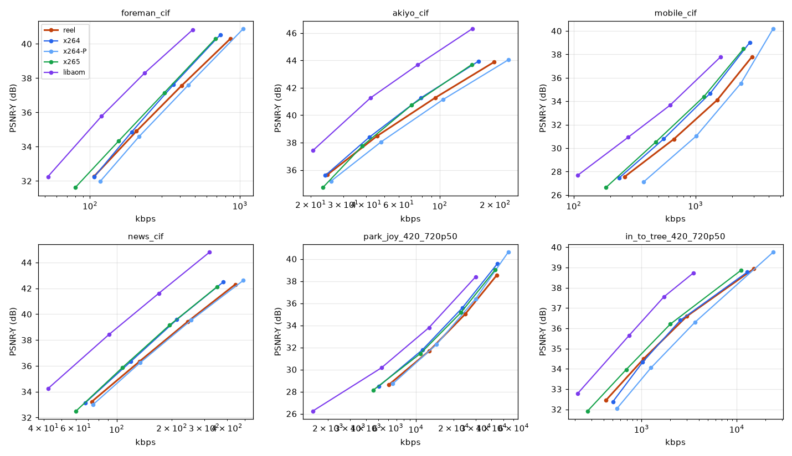

# Reel

A video codec written from scratch, with a browser player and adaptive-bitrate streaming.

| Part | Language | What it does |
|---|---|---|
| `codec/` | Rust | The encoder and decoder. |
| `simd/` | C | AVX2 kernels: the integer DCT, SAD and SATD. They are bit-exact with the Rust versions. |
| `cuda/` | CUDA | Exhaustive motion search on the GPU. It is bit-exact with the CPU reference. |
| `player/wasm/` | Rust → WebAssembly | The decoder for the browser: 80 KB, no imports. |
| `player/src/` | TypeScript | The player: fetches segments, picks renditions (ABR), decodes in wasm and paints a canvas. |
| `server/` | Go | Segmenting at keyframes, a JSON manifest, throttled segment delivery and an ABR simulator. |
| `eval/` | Python | PSNR, SSIM and BD-rate, and the comparison with x264, x265 and libaom. |

The codec uses no third-party crates. About 4,000 lines of Rust plus about 1,950 in the other languages.

## The codec

The codec works on 16×16 macroblocks of 8-bit 4:2:0 video.

**Transforms and quantization**
- Integer DCT at 4×4, 8×8 and 16×16. The transform size is a rate-distortion choice made per macroblock.
- Exact integer arithmetic, so the encoder, the decoder, AVX2 and wasm all reconstruct identical pixels.
- A scalar quantizer: Qstep doubles every 6 QP, with a dead zone of 1/3 for intra blocks and 1/6 for inter blocks.

**Intra prediction**
- 16×16 blocks, or four 8×8 blocks, with DC, vertical, horizontal and plane modes.
- Chroma uses the same four modes.

**Inter prediction**
- Quarter-pel luma with 8-tap filters, and eighth-pel chroma with 4-tap filters.
- Partitions of 16×16, 16×8, 8×16 and 8×8.
- Median motion-vector prediction and a P-skip mode.

**B frames**
- Display order I B P B P …: one B frame between anchors by default (`--bframes N`). Groups are closed at every keyframe.
- Each partition predicts from list 0, list 1 or both (averaged).
- Temporal direct mode scales the co-located vector of the future anchor. It is used for B-skip and also as "direct with residual".
- The decoder reorders frames: B frames are shown at once, and an anchor is shown when the next anchor arrives.

**Motion estimation**
- Candidates come from the predictors, the neighbours, the co-located vector, the scaled temporal vector and, optionally, the exhaustive search.
- A hexagon search and a small diamond follow.
- Then half-pel refinement with SATD (from half-pel planes computed once per reference) and quarter-pel refinement with the exact filter.
- The exhaustive search (`--me full` on the CPU, `--me cuda` on the GPU) seeds the same refinement.

**Rate-distortion decisions**
- Every candidate mode is coded with a bit estimator that uses the live context probabilities.
- The cost is J = SSD + λ·bits, with λ = 0.6·2^((QP−12)/3).
- The split partitions are tried only when their motion cost beats 16×16. Intra in P/B frames is tried only when its SATD is competitive with the best inter SATD.

**Deblocking**
- An in-loop filter on transform and partition edges.
- The boundary strength comes from intra coding, coded coefficients and vector differences. The thresholds follow the H.264 alpha/beta tables.

**Entropy coding**
- A binary adaptive range coder (carry propagation).
- Each context mixes a fast and a slow probability estimator.
- Contexts cover the macroblock syntax, the coded-block patterns and the motion-vector differences. Coefficients use significance and last maps, then greater-than-1 and level bins with Exp-Golomb escapes.
- One generic syntax function serves the encoder, the decoder and the rate estimator, so they cannot disagree.

**Rate control**
- Constant QP (I frames at QP−3, B frames at QP+4).
- Or a one-pass average bitrate: a per-frame-type complexity model (bits × Qstep) with a virtual buffer.
  - On the 300-frame foreman ladder it hit 150, 300, 600 and 1200 kbps targets within 2%.

**Container (`.reel`)**
- A 17-byte header, then one length-prefixed packet per frame (type, QP, payload).
- Streams can be cut at keyframes.

## Results

All results were measured on 2026-11-18 (Windows 11, Intel Core i7-10870H, GeForce RTX 2060).

**Baselines**
- The baselines run through ffmpeg 6.1 from Ubuntu 24.04's apt (`libx264`, `libx265`, `libaom-av1`) inside WSL. They are the only external code in the comparison.
- x264: `-preset medium -tune psnr -qp Q`.
- x264-P: the same, plus `-bf 0 -refs 1`. That leaves x264 with Reel's tool set minus B frames: one reference, no B frames.
- x265: `-preset medium -tune psnr`, `qp=Q`.
- libaom: `-cpu-used 4 -crf C -b:v 0`.

**Setup**
- Every encoder gets one keyframe at the start.
- Rate points: QP 22/27/32/37 for the QP-based encoders and CRF 24/36/48/60 for libaom.
- Frames: 150 of each CIF clip and 60 of each 720p clip.

**What is measured**
- The rate is the raw elementary stream.
  - Reel: 2 header bytes per frame are kept.
  - libaom: the IVF headers are removed.
- Quality is computed by `eval/metrics.py` on the decoded output, then BD-rate is computed (cubic fit, Bjøntegaard). My PSNR matches ffmpeg's `psnr` filter on the same files to 3 decimals.

Full tables: [results/summary.md](results/summary.md). RD curves: [results/rd_curves.png](results/rd_curves.png).

### BD-rate of Reel (PSNR-Y)

Positive means Reel needs that much more bitrate for the same quality.

| clip | x264 | x264-P | x265 | libaom |
|---|---|---|---|---|
| foreman_cif | +10.8% | −9.9% | +16.9% | +111.8% |
| akiyo_cif | +13.0% | −13.2% | +9.7% | +113.7% |
| mobile_cif | +23.1% | −24.7% | +31.6% | +125.0% |
| news_cif | +14.2% | −2.8% | +15.8% | +119.6% |
| park_joy 720p | +16.1% | +1.2% | +11.5% | +57.2% |
| in_to_tree 720p | −1.4% | −27.3% | +21.6% | +160.8% |
| **mean** | **+12.6%** | **−12.8%** | **+17.9%** | **+114.7%** |

With SSIM-Y the means are +10.2% (x264), −16.5% (x264-P), +18.8% (x265) and +142.5% (libaom). With PSNR-YUV (6:1:1) they are +10.2%, −15.2%, +21.3% and +131.9%.



What this says, honestly:
- **Reel against the tools it has.** Reel beats x264 restricted to a comparable tool set (P frames and one reference) by about 13%.
- **Reel against full x264 and x265.** It is 13% behind full x264 medium (B-pyramids, adaptive B placement, several references, trellis quantization) and 18% behind x265 medium.
- **Reel against libaom.** AV1 at cpu-used 4 needs about half of Reel's bits, which is roughly what a modern codec gains over an H.264-class one.
- **Constant QP.** x264 and x265 run at constant QP, which disables their MB-tree and adaptive quantization. These are the usual settings for BD-rate tests. The x264 command line is in `eval/evaluate.py`.

### Tuning that was measured

Settings were tuned on 30 frames of foreman, mobile and news. These are the mean BD-rate figures against x264 and x264-P:

| configuration | vs x264 | vs x264-P |
|---|---|---|
| P only, λ 0.85 | +31.3% | +2.4% |
| 1 B frame, λ 0.6, B at QP+4 | **+16.0%** | **−9.1%** |
| 2 B frames, λ 0.6, B at QP+5 | +16.3% | −8.8% |

The default is one B frame. It gives the same result as two B frames, encodes faster and has lower latency.

### Speed

All speed figures are single-threaded. The baselines use `-threads 1` (x265 `pools=1:frame-threads=1`, libaom `-row-mt 0`). Reel runs one encoder thread.

| clip | encoder | encode fps | decode fps | motion search |
|---|---|---|---|---|
| foreman CIF (150 frames) | Reel, hexagon search | 15.3 | 351 | |
| | Reel, exhaustive ±32 on the CPU | 2.17 | 346 | 59.4 s |
| | Reel, exhaustive ±32 on CUDA | 15.1 | 352 | 0.45 s (132×) |
| | x264 medium | 237 | 2344 | |
| | x264-P | 378 | 2632 | |
| | x265 medium | 104 | 1852 | |
| | libaom cpu-used 4 | 11.5 | 1807 | |
| park_joy 720p (60 frames) | Reel, hexagon search | 1.60 | 39.4 | |
| | Reel, exhaustive ±32 on the CPU | 0.24 | 39.5 | 212.7 s |
| | Reel, exhaustive ±32 on CUDA | 1.47 | 41.2 | 1.56 s (136×) |
| | x264 medium | 21.2 | 230 | |
| | x264-P | 27.3 | 220 | |
| | x265 medium | 7.34 | 127 | |
| | libaom cpu-used 4 | 0.59 | 160 | |

Reel encodes 13–16× slower than x264. Its decoder is 6–7× slower than ffmpeg's H.264 decoder. Reel's encoder does a full rate-distortion trial of every candidate mode with no early exits beyond the two gates above, and nothing in it is vectorized except the transforms, SAD and SATD. Being 5–7× slower than x265 medium and faster than libaom is where that leaves it.

The exhaustive ±32 search returns identical vectors on the CPU and the GPU. The test `gpu_matches_the_cpu_reference` checks this, and the two streams are byte-identical. Motion search time drops by more than 100× on the GPU, but Reel's default hexagon search is faster still and about as good. The value of the GPU search is that it makes an exhaustive search affordable.

The AVX2 kernels gave the same stream with the encoder ~1.4× faster (8.6 versus 6.2 fps on CIF before the B-frame work). The decoder in the browser (wasm) needs about 5 ms per CIF frame.

### Adaptive streaming

`reel-server simulate` runs the three ABR rules (`throughput`, `buffer` = BBA-0, `hybrid` = the player's rule) over bandwidth traces. The input is the real segment sizes of the foreman ladder: renditions of 153, 305, 604 and 1204 kbps, 1 s segments, repeated to 240 s.

| trace | rule | avg kbps | rebuffering | switches |
|---|---|---|---|---|
| constant 3000 kbps | throughput | 1200 | 0 s | 1 |
| | buffer | 1107 | 0 s | 3 |
| | hybrid | 1185 | 0 s | 3 |
| step 4000/800 kbps, 30 s each | throughput | 975 | 0 s | 7 |
| | buffer | 1020 | 0 s | 39 |
| | hybrid | 955 | 0 s | 9 |
| wave 400–4000 kbps | throughput | 975 | 0 s | 15 |
| | buffer | 1040 | 0 s | 10 |
| | hybrid | 981 | 0 s | 17 |
| drop to 300 kbps for 15 s | throughput | 1103 | 0 s | 7 |
| | buffer | 1077 | 0 s | 5 |
| | hybrid | 1095 | 0 s | 9 |

No rule stalls on these traces. The traces are generous next to this small CIF ladder, so the table compares quality and stability more than stall avoidance. BBA oscillates on the step trace (39 switches). The two throughput-based rules stay within a few percent of each other, and the hybrid rule trades a little bitrate for its buffer safety margin.

In the browser at an emulated 600 kbps, the player climbed from 150k to 300k and stayed there. 0.9 × 598 kbps is below 600k. It played without stalls and decoded at about 5 ms per frame.

## Building

The core build needs:
- Rust stable.
- Optional: clang or cc for the AVX2 kernels, and the CUDA toolkit for `--features cuda`.

The other parts need:
- Go 1.24 for the server.
- Node 24 for the player.
- Python 3.10+ with numpy for the evaluation, and matplotlib for the plots.
- ffmpeg with libx264, libx265 and libaom for the baselines.

```bash
cd codec && cargo build --release                   # reel encode|decode|info|checksum
cd codec && cargo build --release --features cuda   # adds --me cuda (nvcc; on Windows it finds cl.exe with vswhere)
cd player && npm ci && npm run wasm && npm run build
cd server && go build -o reel-server .
```

## Using it

```bash
reel encode in.y4m -o out.reel --qp 30                        # constant QP
reel encode in.y4m -o out.reel --bitrate 600 --keyint 60      # average bitrate (kbps)
reel encode in.y4m -o out.reel --me cuda --recon recon.y4m -v # GPU motion search, per-frame stats
reel decode out.reel -o out.y4m

scripts/fetch_clips.sh                                         # the Xiph clips into data/clips
python scripts/ladder.py data/clips/foreman_cif.y4m --kbps 150 300 600 1200 --keyint 30
cd server && ./reel-server serve -seg 1                        # player at http://localhost:8090/
./reel-server simulate -seg 1                                  # ABR algorithms on bandwidth traces

python eval/evaluate.py quality     # all rate points (baselines through ffmpeg; on Windows inside WSL)
python eval/evaluate.py speed
python eval/evaluate.py report      # results/summary.md and results/rd_curves.png
```

In the player you choose a stream and a network: unlimited, a fixed rate, or a trace. The server throttles segment transfers to match. The player's ABR is the same rule as the Go `hybrid` algorithm, and both are checked against shared test vectors in `server/testdata/abr_vectors.json`.

## Tests

- **Rust:**
  - The transform round trip, quantization, zig-zag scans and basis orthogonality.
  - The range coder: round trips, carries, and the accuracy of the bit estimate.
  - Intra prediction, motion compensation and the motion searches.
  - The macroblock syntax round trip for P and B frames.
  - AVX2 against scalar, and the GPU against the CPU (with `--features cuda`).
  - End to end: the decoder must reproduce the encoder's reconstruction bit for bit (P only, 2 B frames, 3 B frames with exhaustive search). Also rate-distortion monotonicity, rate-control accuracy and corrupt streams.
- **TypeScript:** the wasm decoder must reproduce the native decoder's per-frame checksums on `player/test/fixture.reel`, a synthetic clip with B frames. Also the ABR vectors and the container parser.
- **Go:** segmentation at keyframes, manifest and segments over HTTP, throttling accuracy, the ABR vectors, and simulation invariants.
- **Python:** PSNR, SSIM and BD-rate on known cases.
- **CI** (`.github/workflows/ci.yml`) runs all of these. It also runs a 20-frame Reel-vs-x264 comparison with Ubuntu's ffmpeg. CUDA is not tested in CI because there is no GPU.

## Limits

- 8-bit 4:2:0 only. Picture sizes are padded to multiples of 16.
- Single-threaded encoder and decoder. There is no slice or wavefront parallelism.
- One reference picture per list. There are no hierarchical B frames and no adaptive B placement.
- B frames use 16×16 partitions or direct mode only.
- No intra 4×4 and no directional intra modes beyond the four listed.
- No trellis or RDO quantization. There is no adaptive quantization, so the QP is per frame.
- The rate control is one pass. There is no lookahead and no VBV guarantee.
- Error resilience: a corrupt packet gives an error or garbage, never a crash, but there is no concealment.
- The quarter-pel motion search uses the exact filter, and the half-pel search reads precomputed planes. The exhaustive search covers ±32 pixels.
- The evaluation uses 150 frames of each CIF clip and 60 of each 720p clip.
- The Xiph clips are downloaded, not committed.

## Data and licenses

The code is under the MIT license (`LICENSE`).

The test clips come from the Xiph.org Derf collection (media.xiph.org/video/derf) and are downloaded by `scripts/fetch_clips.sh`.

`player/test/fixture.reel` is a synthetic clip made by `scripts/make_fixture.py`.

The baseline encoders are not part of this repository.
